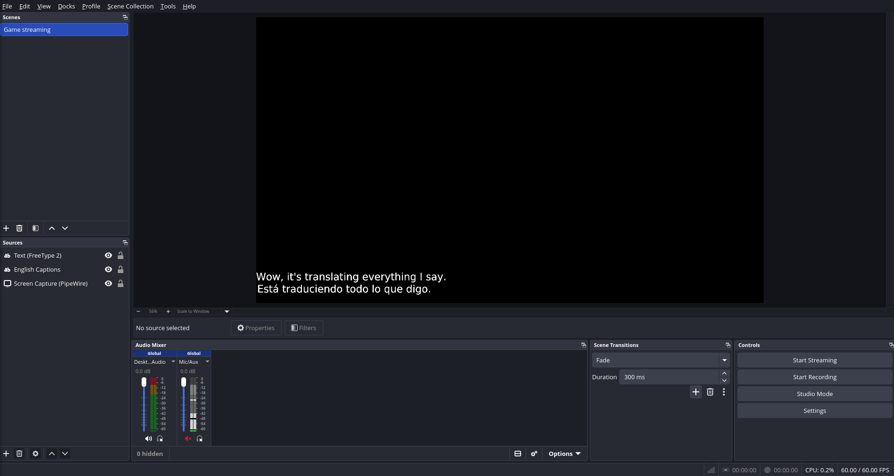
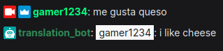

# Stream Translator

Stream Translator is a simple Python script that listens to English speech from your microphone, and generates captions in multiple languages. It writes captions in real time to text files for each language you choose to translate to, which can be used by [OBS text sources](https://obsproject.com/kb/text-sources) or an equivalent tool. Then, if you configure any languages to translate to, it will output those translations to their own text files. Optionally, you can set up a Twitch bot that translates non-English messages from chatters into English.

### OBS Example


### Translation Twitch Bot Example



### Intended Use

This tool is meant to be a convenient all-in-one script you can run on your streaming PC, and is not intended as a production scale application. Under the hood, this script runs a local LibreTranslate server for the translation API, and a Twitchio client to run the twitch bot. The speech recognition is done using a locally installed OpenAI Whisper model. If you want a similar setup that runs LibreTranslate, Twitchio, and/or OpenAI Whisper as separate remote services, feel free to fork this repository and modify it for your use case.

## Installation

Before using the tool, you will need to install the following prerequisites:
- [Python](https://www.python.org/downloads/) 3.12+ or greater
- [uv](https://docs.astral.sh/uv/getting-started/installation/)
- (Optional) [CUDA Toolkit](https://developer.nvidia.com/cuda-toolkit-archive) 12.x for running translation models on your Nvidia GPU

Then, clone the script into the folder of your choice:
```
git clone https://github.com/robyn-dressler/stream-translator.git
```

### Configuration
All tool settings can be managed in the `config.py` file. When you first clone the repo, copy `config.example.py` and rename it to `config.py` to create an empty configuration. See the table below for the list of available settings. If using the Twitch translation bot, remember to configure the settings starting with `twitch_` (see [Setting Up Twitch](#setting-up-twitch)). 

|Setting   |Default   |Description   |
|---|---|---|
|translate_to_languages   | []  |A list of languages to generate captions for, e.g. ["spanish","french"]  |
|enable_cuda   | False  |Run the speech recognition and translation models with CUDA for better performance. Only enable if you have an Nvidia GPU and you installed the CUDA toolkit version 12.   |
|twitch_client_id   | N/A  |The Client ID generated for your application in the Twitch Developer Console.|
|twitch_client_secret   | N/A  |The Client Secret generated for your application in the Twitch Developer Console.   |
|twitch_owner_login   | N/A  |Your Twitch username.|
|twitch_bot_login   | N/A  |Your Twitch bot account's username.   |
|twitch_broadcaster_logins   | N/A  |A list of twitch channel names you want your bot to subscribe to, e.g. ["streamer1", "streamer2"]  |
|twitch_redirect_uri   | http://localhost:4343/oauth/callback  |The OAuth Redirect URL you set in your Twitch Developer Console. This generally should not change unless you are also changing the bot code.  |

### Setting Up Twitch

1. Login to the [Twitch Dev Console](https://dev.twitch.tv/console)
2. Click Register Your Application
3. Choose a name for your application
4. Add http://localhost:4343/oauth/callback as your OAuth Redirect URL (unless you are setting up a custom url)
5. Choose "Chat Bot" as the category
6. Choose "Confidential" for the Client Type
7. Click create, then generate a client secret and save it somewhere secure
8. Make a new Twitch account to use as your bot, or use an existing one

## Running the Tool
Open a terminal in the folder you downloaded stream-translator to and run the command corresponding to your OS:

**Windows**
```
.\start.bat
```

**Linux**
```
chmod +x ./start.sh
./start.sh
```

On the first startup, you will be prompted to log in as the bot user, and then as the stream user. After that is complete, it may take a little while to download the models used for translation. Once it finally starts up, it will begin listening for your microphone input. You'll know it's working if it starts showing translations in the terminal, and if you can see a new `english.txt` file in the stream-translator folder along with any other languages you selected.

To shut it down, just use `ctrl+C` in the terminal.
